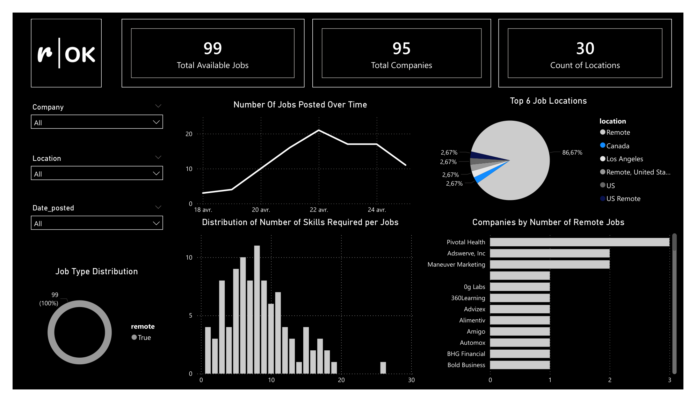

# Remote Job Market Analytics | Python & Power BI

**API data extraction · Data cleaning · Exploratory analysis · Power BI**

An academic project exploring remote-job listings, reported locations, employers, and recurring skill tags. Data was obtained from the [Remote OK API](https://remoteok.com/api).

## Project workflow

1. **Extract:** Retrieve a snapshot of Remote OK's JSON API with Python `requests`.
2. **Clean:** Remove missing title/company records, duplicate URLs and an obvious test listing; standardize dates and tags with `pandas`.
3. **Analyze:** Summarize employers, locations, listing tags, tag counts, and posting dates.
4. **Visualize:** Generate charts with `matplotlib` and examine the original Power BI report.

## Power BI dashboard

The Power BI report is available as [`scraper.pbix`](powerbi/scraper.pbix). For a quick view without Power BI Desktop, open the [dashboard PDF preview](powerbi/Scraper%20Power%20BI%20Dashboard.pdf).



The preview is generated from the dashboard PDF.

## Repository structure

| Path | Contents |
| --- | --- |
| [`src/extract_remoteok.py`](src/extract_remoteok.py) | API-based data collection |
| [`src/clean_jobs.py`](src/clean_jobs.py) | Cleaning and quality checks |
| [`src/visualize_jobs.py`](src/visualize_jobs.py) | Charts and skill-tag frequency export |
| `data/` | Archived raw and cleaned CSV snapshots, plus skill-tag frequency table |
| `powerbi/` | Power BI `.pbix` dashboard and PDF preview |
| `docs/` | Final academic report and presentation |
| `images/charts/` | Generated plots after running the visualization script |

## Reproduce the Python workflow

From the repository root:

```bash
pip install -r requirements.txt
python src/extract_remoteok.py --output outputs/jobs_data.csv
python src/clean_jobs.py --input outputs/jobs_data.csv --output outputs/jobs_final_cleaned.csv
python src/visualize_jobs.py --input outputs/jobs_final_cleaned.csv --charts outputs/charts --skills-output outputs/skills_frequency.csv
```

The extraction step accesses a **live API** and will produce a different snapshot over time. The commands above write to the ignored `outputs/` directory, leaving the archived academic datasets untouched. To analyze the archived snapshot instead, run `python src/visualize_jobs.py --input data/jobs_final_cleaned.csv --charts outputs/archived_charts --skills-output outputs/archived_skills_frequency.csv`.

## Validation and dashboard reconciliation

An automated pipeline validation successfully ran the revised cleaning and visualization scripts on the archived raw CSV and verified that charts and a skills-frequency table were generated.

| Metric | Archived cleaned CSV | Revised cleaning output | Power BI dashboard PDF |
| --- | ---: | ---: | ---: |
| Job listings | 99 | 97 | 99 |
| Distinct companies | 94 | 93 | 95 |
| Distinct locations | 31 | 30 | 30 |

**Important:** The Power BI figures are reproduced as shown in the saved dashboard PDF, not recalculated from the PBIX model. Its company and location measures have **not** been independently verified against the underlying Power BI model, and the differences should not be interpreted as confirmed errors. The revised cleaning applies additional exclusions, including an obvious test listing; its outputs are not intended to match the historical dashboard exactly.

## Interpretation and limitations

- The dataset is a **snapshot of one job board**, not a representative sample of the entire global remote-job market.
- API tags may include broad descriptors such as “senior” or “support”; they should not all be interpreted as technical skills.
- The source's salary field is not reliably standardized, so the revised cleaning script does not calculate a salary midpoint.
- Some archived listing text shows encoding artifacts. Those values require source verification rather than speculative corrections.
- This repository documents an **educational analytics workflow**, not a live labor-market monitoring service.

## Documentation

- [Final project report](docs/Final_Report.pdf)
- [Final presentation](docs/Final_Presentation.pdf)

## Project context

This project was developed as academic coursework. The Python workflow has been reorganized for readability. The revised cleaning and visualization scripts passed automated validation on the archived raw dataset. Live API extraction has not been tested by this workflow.
